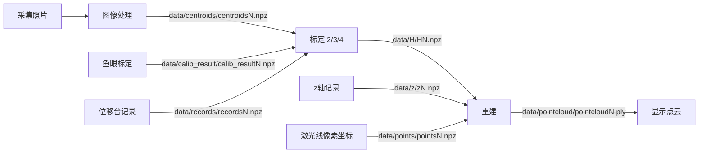

## 产品概述

为环形结构光 3D 点云系统编写一个图形化主程序，把「采集 → 记录 → 图像处理 → 标定 → 重建 → 显示」全流程整合到统一界面。主程序是启动器，7 个功能模块各自独立弹窗，按需打开，不挤在同一界面。

## 核心功能

- **主程序启动器**：7 个模块入口按钮（采集图像、位移台记录、z 轴记录、图形处理、标定、重建、显示点云），点击后弹出对应模块窗口。
- **采集图像**：改造现有采集程序，加入查找相机、连接、断开功能；可选择照片保存文件夹（不存在则创建）；自动在照片文件夹同级生成 `data` 数据文件夹。
- **位移台记录**：复用现有平移台软件，记录 xy 移动量与四点坐标。
- **z 轴记录**：新建程序，手动输入 z 深度值累积成序列，保存为 `z.npz`。
- **图形处理**：调用现有「图像处理_四点提取」函数，从照片文件夹提取四点像素坐标。
- **标定**：含鱼眼标定（第一步）与第 2/3/4 步，共 4 个按钮，产出 `calib_result`、初始四点坐标、`ang_move`、`H`。
- **重建**：调用现有点云重建代码，用 H 与像素坐标、z 坐标生成 PLY 点云。
- **显示点云**：用 open3d 打开并显示重建生成的 PLY。
- **文件管理**：所有输出文件自动在文件名后加数字排序；读取时若存在多个数据则取最后一个。

## 技术栈

- 运行环境：Python 3.8（`py -3.8`），tkinter 为标准库自带。
- GUI：tkinter + ttk（复用现有采集程序与平移台软件的技术栈）。
- 数值/图像：numpy 1.24.4、opencv-python 4.13.0。
- 点云显示：open3d 0.19.0（已装，`o3d.io.read_point_cloud` + `draw_geometries`）。
- 相机：pypylon（当前 `py -3.8` 及 3.12/3.13/3.14 均未检测到，需延迟导入兜底）。

## 实现方案

### 总体架构

采用「启动器 + 模块弹窗」模式：新建 `main.py` 用 `tk.Tk` 做主窗口，7 个按钮各自创建 `tk.Toplevel` 并挂载对应模块类。现有 `CaptureApp`、`StageApp` 的构造函数都接收 `root` 参数，可零改动复用；算法模块（图像处理/标定/重建/显示点云）用轻量参数窗口封装后调用已有函数，避免改动核心算法代码。

### 目录与文件约定

用户选定「工作目录」后，自动创建统一数据文件夹 `data/`，内部按文件类型各建一个子文件夹（共 9 个）：

- `data/calib_result/`：鱼眼标定结果（`calib_resultN.npz`，含 K/D/rms）
- `data/centroids/`：四点交点像素坐标（`centroidsN.npz`）
- `data/records/`：平移台 xy 移动记录（`recordsN.npz`）
- `data/初始四点坐标/`：初始四点现实坐标（`初始四点坐标N.npz`，含 ang1/ang2）
- `data/ang_move/`：位移台夹角（`ang_moveN.npz`）
- `data/H/`：单应矩阵（`HN.npz`）
- `data/points/`：激光线像素坐标（`pointsN.npz`）
- `data/z/`：深度值（`zN.npz`）
- `data/pointcloud/`：重建点云（`pointcloudN.ply`）

每个子文件夹内同名文件按序号自动编号；读取时取序号最大的最后一个。照片本身存 `工作目录/` 下（或用户另选的照片文件夹），标定棋盘格照片仍用独立文件夹。

### 公共工具模块

新建 `核心代码/文件工具.py`（或主程序内工具函数），提供：

- `next_path(dir, base, ext)`：扫描 `base\d+ext` 取最大序号 +1，返回新路径，实现自动编号。
- `latest_file(dir, base, ext)`：按序号排序取最后一个文件，实现「多个数据取最后一个」。
- `ensure_data_dirs(work_dir)`：确保 `data/` 及其下 9 个子文件夹存在。

### 各模块数据流

标定内部中间文件（初始四点坐标、ang_move）分别存入 `data/初始四点坐标/`、`data/ang_move/`。

### 关键决策与风险

- **pypylon 缺失兜底**：采集模块对 `from pypylon import pylon` 做 try/except 延迟导入；缺失时「采集图像」按钮弹窗提示需在装有 pypylon 的环境运行，不影响其余 6 个模块正常启动。
- **图像处理交互弹窗**：现有 `image_processing` 内部有 `cv2.imshow` + `waitKey(0)` 逐图人工确认，集成时保留原行为，在调用前用提示说明操作方式。
- **复用优先**：标定/重建/图像处理直接 import 已有函数（`calibrate`、`calibrate_step2/3/4`、`image_processing`、`reconstruct`），不复制算法逻辑。

### 界面设计（美观方案）

- 主界面采用现代化启动器：顶部标题栏 + 模块卡片网格，每个模块卡片含名称与一行说明，鼠标悬停高亮、点击弹出对应窗口。
- 使用 `ttk.Style` 统一主题（`clam` 基底），自定义配色：深色主色调 + 高对比强调色，按钮圆角感通过 padding 与配色营造。
- 各模块弹窗保持简洁分区：顶部参数区、中部预览/表格区、底部操作按钮区，状态与错误用 label 颜色区分。
- 采集界面在现有布局上新增「相机管理」区（查找/连接/断开 + 状态灯），保存设置区增加 `data` 数据文件夹（含 9 个子目录）自动创建提示。

## 推荐扩展

### Skill

- **code-rules**
- 用途：编写与修改代码时遵守向子坚的个人代码规范（函数头注释写清功能/输入/输出、核心变量首次出现处注释、克制 print、函数模块化、优先复用已有函数与内置函数、git 管理、不新装软件先查已有环境）。
- 预期结果：所有新增/修改文件符合规范，函数带「功能/输入/输出」docstring，改动最小化，复用现有 `CaptureApp`、`StageApp` 与各算法函数。