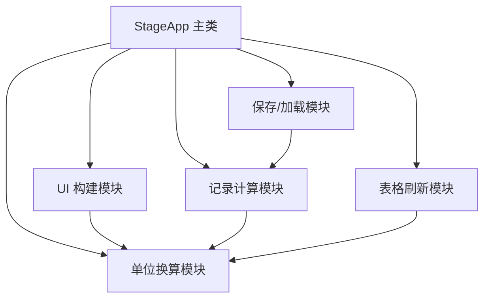

## 产品概述

一个基于 Windows 桌面的平移台坐标记录工具，用于环形结构光点云重建实验中跟踪四边形四个顶点（P1~P4）随 xy 平移台移动后的坐标变化。软件不控制硬件，仅作为"坐标计算 + 记录台账"使用：用户设置初始四点坐标，每次手动输入平移台移动方向与距离，软件自动算出新的四点坐标，并以表格形式展示历史记录，支持保存到 npz 与手动删除。

## 核心功能

- 初始四点坐标设置：按固定顺序输入四边形四顶点 P1/P2/P3/P4 的 x、y 坐标
- 单位切换：支持 mm / μm / px 多单位，坐标与移动距离统一使用当前单位；px 通过可设置的像素比例尺换算
- 方向可配置：平移台向 x/y 正半轴移动时，坐标增量是 +dx 还是 -dx 可全局配置
- 移动记录：每次输入 x 移动方向（正/负）与距离、y 移动方向（正/负）与距离，软件自动计算并追加一条新四点坐标记录
- 历史显示：表格展示初始记录（第 0 条）及历次移动结果，每条含移动量 dx/dy 与四个点的 xy 坐标
- 保存与删除：一键保存全部记录到 npz（含单位、比例尺、方向配置）；可选中并删除某一条记录，其余记录不受影响

## 技术栈

- 语言：Python 3
- GUI：tkinter + ttk（Python 标准库内置，免安装，符合"不新装软件"约束）
- 数值与存储：numpy（`np.savez_compressed` / `np.load`），与项目现有依赖一致

## 实现方案

采用单文件桌面 GUI，内部统一以 **mm 为基准单位** 存储所有坐标，显示与输入时按当前单位换算，避免切换单位时数据不一致。数据模型为"记录列表"：第 0 条为初始坐标，其后每条记录保存"绝对四点坐标 + 本次移动量(dx,dy)"。新坐标由上一条记录的四点坐标整体平移得到，删除某条记录只移除该条、不影响其他记录的绝对坐标。

### 单位换算

- mm：1 mm = 1
- μm：1 μm = 0.001 mm
- px：通过可设置的像素比例尺 `scale_px_per_mm`（px/mm）换算，`mm = px / scale`
- 提供 `_to_base(value)` 与 `_from_base(value)` 两个换算函数，分别在写入和显示时调用

### 方向约定（两层方向，需区分）

- 全局方向配置 `dir_x ∈ {+1, -1}`、`dir_y ∈ {+1, -1}`：表示"平移台向 x 正半轴移动 1 mm 时，坐标增量为 `dir_x × 1` mm"，用于消除平移台与图像坐标轴方向不一致的问题，仅需设置一次
- 每次移动输入：用户选择 x 移动方向（+X/−X）与距离、y 移动方向（+Y/−Y）与距离
- 实际坐标增量：`dx_mm = dir_x × x_sign × _to_base(x_dist)`，`dy_mm = dir_y × y_sign × _to_base(y_dist)`，其中 `x_sign/y_sign` 为本次选择的 ±1

### 数据模型

```python
# 每条记录（内部 mm）
record = {
    "dx": float,            # 本次 x 移动量（mm），第 0 条为 0
    "dy": float,            # 本次 y 移动量（mm），第 0 条为 0
    "points": [(x1,y1),(x2,y2),(x3,y3),(x4,y4)]  # 绝对四点坐标（mm）
}
```

应用状态：`records: list[record]`、`unit`、`scale_px_per_mm`、`dir_x`、`dir_y`。

### GUI 布局

- 顶部「初始设置区」：P1~P4 的 x/y 输入框（共 8 个）、单位下拉框（mm/μm/px）、像素比例尺输入框（选 px 时启用）、x 方向配置（+1/−1）、y 方向配置（+1/−1）、"设置/更新初始坐标"按钮
- 中部「移动输入区」：x 方向下拉（+X/−X）+ x 距离输入框、y 方向下拉（+Y/−Y）+ y 距离输入框、"添加移动记录"按钮
- 主体「记录表格」：`ttk.Treeview`，列为 序号、dx、dy、P1(x,y)、P2(x,y)、P3(x,y)、P4(x,y)，坐标按当前单位显示
- 底部「操作区」："保存到 npz"、"加载 npz"、"删除选中记录" 按钮；切换单位时刷新表格显示

### 保存与加载（npz）

- 保存：`np.savez_compressed` 写入 `points`(N,4,2)、`dx`(N,)、`dy`(N,)（均为 mm）、`unit`、`scale_px_per_mm`、`dir_x`、`dir_y`，使用 `filedialog.asksaveasfilename` 指定路径
- 加载：`np.load` 反向恢复全部状态并刷新表格
- 复用项目现有 `np.savez_compressed` 用法，保持文件格式可被 numpy 直接读取

### 边界处理

- 未设置初始坐标时，"添加移动记录"按钮禁用或弹窗提示
- 切换到 px 单位但未设置比例尺时，弹窗提示并阻止换算
- 删除到空列表后，移动添加按钮回到需先设置初始坐标的状态
- 加载 npz 时校验必要键是否存在，缺失则提示格式错误

## 架构设计

单文件分层，逻辑与 UI 分离，函数模块化：



- UI 构建：创建输入区、按钮、Treeview，绑定回调
- 单位换算：`_to_base` / `_from_base`，统一入口
- 记录计算：初始坐标设置、移动增量计算、新四点坐标生成
- 表格刷新：把内部 mm 记录按当前单位渲染到 Treeview
- 保存/加载：npz 序列化与反序列化

## 目录结构

```
c:/python/3D_project_3/
└── 平移台软件/
    └── 平移台软件.py   # [NEW] 单文件 tkinter GUI
                        # 包含 StageApp 主类，实现：初始四点坐标设置、多单位换算、
                        # 方向可配置、移动记录添加、Treeview 历史显示、删除记录、
                        # npz 保存/加载。函数头注释写清功能/输入/输出，核心变量首次出现处注释含义
```

## 实现要点

- 遵循 code-rules：函数头注释（功能/输入/输出）、核心变量注释、只写核心代码、不写测试样例、克制 print、函数模块化
- 所有坐标与移动量在内存中统一为 mm，仅在输入/显示边界做单位换算，降低切换单位引入的误差
- 删除记录仅操作 `records` 列表与对应 Treeview 行，不重算其他记录，保证"删除某一条"语义干净
- 性能：记录为人工逐条添加，数量很小，每次操作 O(1)，无性能瓶颈

## 推荐使用的 Agent 扩展

### Skill

- **code-rules**
- 用途：在编写平移台软件全程遵守用户个人代码规范（函数头注释、变量注释、最小化改动、模块化、克制 print、不写测试样例）
- 预期结果：产出符合向子坚规范的、结构清晰、注释到位的单文件 GUI 代码，不引入多余文件