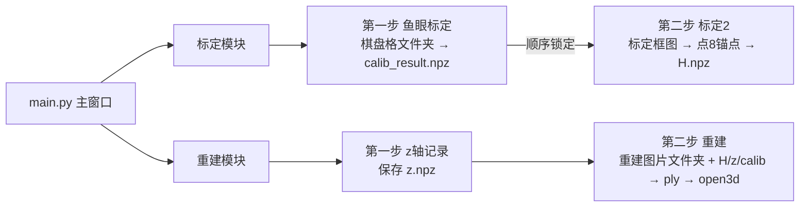

## 产品概述

在 `核心代码_标定2` 目录新建一个 `main.py` 桌面主程序，把该目录下分散的脚本串成「标定」「重建」两个步骤化模块，提供统一的可视化入口与顺序引导。

## 核心功能

### 标定模块（两步，顺序锁定）

- 输入：① 拍摄有棋盘格的文件夹（给鱼眼标定）② 拍摄有标定框的文件夹（给标定2，仅放一张标定框图）。
- 第一步「鱼眼标定」：运行 `鱼眼标定.py`，产出 `calib_result.npz`；未完成前第二步不可点击。
- 第二步「标定2」：自动取标定框文件夹里唯一一张图，人工在图上点 8 个锚点，运行 `标定2.py`，产出 `H.npz`。
- 输出：`H.npz`。

### 重建模块（两步）

- 第一步「z 轴记录」：打开 z 轴记录窗口，记录并保存 z 坐标序列（`z.npz`）。
- 第二步「重建点云」：选择重建图片文件夹，自动引用标定模块产出的 `calib_result.npz`、`H.npz` 与 z 记录产出的 `z.npz`，运行 `重建.py` 生成点云，并用 open3d 弹出窗口显示结果。

### 界面要求

- 主窗口提供「标定」「重建」两个入口卡片，深色卡片风格与现有 `标定1/main.py` 一致。
- 各模块采用步骤化分区布局，标定模块严格顺序锁定，重建模块执行前校验前置产物。

## 技术栈

- 语言：Python 3.8+（与现有 `main.py` 的 `py -3.8` 运行方式一致）
- GUI：tkinter + ttk，深色卡片配色复用 `标定1/main.py`（`_BG=#1f2430`、`_CARD=#2b3242`、`_ACCENT=#4c9aff` 等）
- 模块加载：`importlib.util` 动态加载中文文件名脚本
- 算法依赖：cv2、numpy、open3d（点云显示）

## 实现方案

### 1. 参数化现有脚本（最小改动，逻辑不变）

- `标定2.py`：新增可参数调用的 `calibrate2(...)`，把 `main()` 的完整流程迁入并参数化输入输出；`main()` 改为委托调用，保持脚本可直接运行。
- `重建.py`：新增可参数调用的 `reconstruct(...)`，用显式 `calib_npz` 参数替代当前第 93 行 `np.load(proc.CALIB_NPZ)`；`main()` 委托调用，保留默认值回退以兼容直接运行。

### 2. 新建 main.py 主程序

- 顶部将 `核心代码_标定1` 目录加入 `sys.path` 并加载 `文件工具` 注入 `sys.modules["文件工具"]`，解决 `z轴记录.py` 中 `import 文件工具` 的依赖（标定2 目录缺此文件）。
- 主窗口：标题 + 工作目录选择 + 「标定」「重建」两个卡片；点卡片弹 `Toplevel` 子窗口。
- 产物统一放入工作目录下 `data/` 子目录（复用 `文件工具.next_path` / `latest_file`）：
- `calib_result` → `data/calib_result/calib_resultN.npz`
- `H` → `data/H/HN.npz`
- `z` → `data/z/zN.npz`（由 z轴记录自行保存）
- `pointcloud` → `data/pointcloud/pointcloudN.ply`

### 3. 步骤化与顺序锁定

- 标定模块用 `tk.Entry/ttk.Button` 的 `state="disabled"` 实现第二步锁定，第一步执行成功后才 `state="normal"`。
- 重建模块第二步执行前用 `latest_file` 校验 `z.npz`、`H.npz`、`calib_result.npz` 是否已存在，缺失则提示先完成前置步骤。

## 关键代码结构

```python
# 标定2.py 新增（接口级）
def calibrate2(image_path=IMAGE_PATH, calib_npz=CALIB_NPZ, out_npz=OUTPUT_NPZ, imgproc_path=_IMGPROC_PATH):
    """功能：处理单张标定框图→人工点8锚点→求单应矩阵H→存npz。返回 H(3,3) 或 None。"""

# 重建.py 新增（接口级）
def reconstruct(image_dir=IMAGE_DIR, h_npz=H_NPZ, z_npz=Z_NPZ, calib_npz=None, out_ply=OUTPUT_PLY, proc_path=PROC_PATH):
    """功能：逐图提取骨架→H映射现实XY→配z→写ply。calib_npz 为 None 时回退 proc.CALIB_NPZ。返回 out_ply 路径或 None。"""
```

## 模块流程



## 目录结构

```
核心代码_标定2/
├── main.py              # [NEW] 主程序：主窗口 + 标定/重建两模块步骤化 Toplevel 窗口
├── 标定2.py             # [MODIFY] 参数化：_IMGPROC_PATH 指向本目录图像处理.py，新增 calibrate2()
├── 重建.py              # [MODIFY] 参数化：新增 reconstruct()，用 calib_npz 参数替代 proc.CALIB_NPZ
├── 鱼眼标定.py          # 不改动，直接复用 calibrate(path, out_npz)
├── 图像处理.py          # 不改动，被标定2 复用
├── 图像处理_重建.py     # 不改动，被重建复用
├── z轴记录.py           # 不改动，复用 ZRecorderApp(root, work_dir)
└── data/                # 产物目录（calib_result/H/z/pointcloud 子目录）
```

## 实现要点

- `标定2.py` 的 `_IMGPROC_PATH` 改为 `os.path.join(os.path.dirname(os.path.abspath(__file__)), "图像处理.py")`，使其指向本目录的 `图像处理.py`（原指向标定1，与需求不符）。
- `标定2` 的标定框图取法：`sorted(glob.glob(folder/*.png) + glob.glob(folder/*.jpg))` 取第一张。
- 点云显示复用标定1 `_open_view` 的 open3d 弹窗逻辑，并处理 open3d 未安装 / ply 为空的异常提示。
- 所有算法调用沿用标定1 `wrap` 模式：`try/except` 捕获异常并显示到状态栏，避免界面卡死。

## 推荐的 Agent 扩展

### Skill

- **code-rules**
- 用途：在编写与重构 `main.py`、`标定2.py`、`重建.py` 时遵守用户代码规范——函数头注释写清功能·输入·输出、核心变量首现处注释含义、函数模块化且改动最小化、优先复用已有函数、克制使用 print、遇到信息缺口先提问。
- 预期结果：新增/修改代码风格与现有 `标定1` 脚本一致，改动仅限必要范围，不引入测试样例或临时文件。